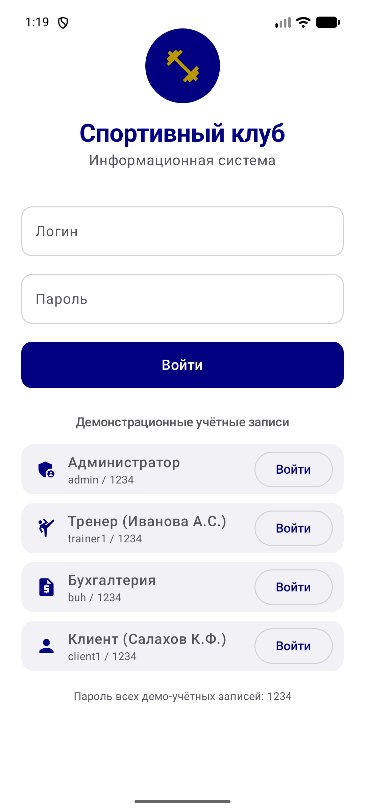
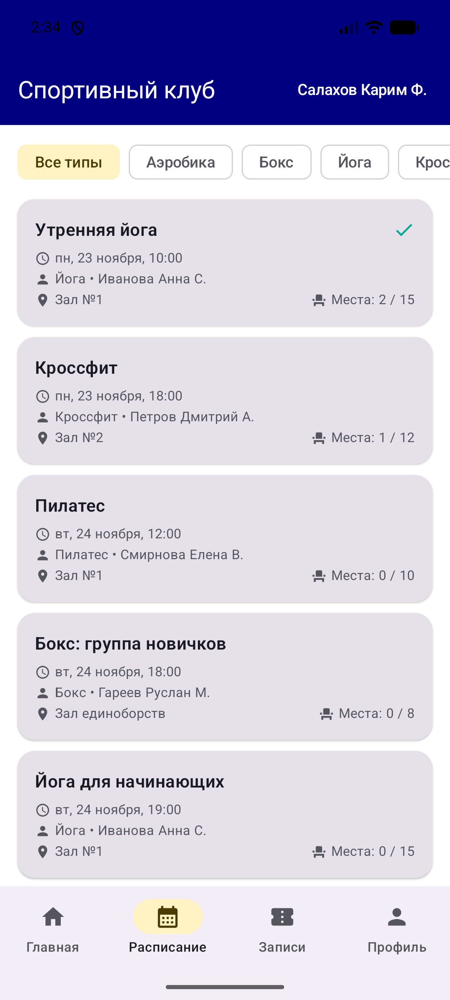
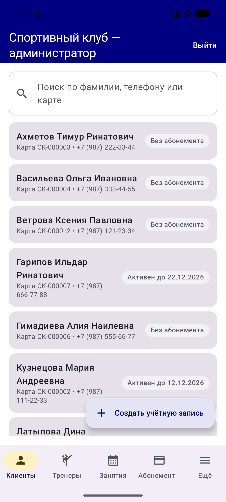
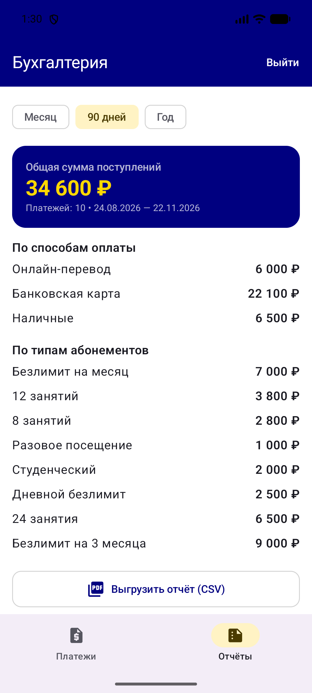

# 🏋️ ИС «Спортивный клуб» — мобильное приложение

[](https://developer.android.com)
[](https://kotlinlang.org)
[](https://developer.android.com/jetpack/compose)
[](https://www.sqlite.org)
[-blue)]()

Мобильное приложение корпоративной информационной системы **«Спортивный клуб»** для платформы Android.
Приложение объединяет в себе интерфейсы всех ролей клуба — от клиента до бухгалтерии — и работает
с локальной базой данных SQLite с полным контролем целостности: внешние ключи, транзакции и **10 триггеров**.

Курсовая работа, Университет управления «ТИСБИ», группа П-311.

---

## 📹 Демонстрация работы

Видео со всеми ролями приложения (клиент, администратор, тренер, бухгалтерия) — **[docs/demo.mp4](docs/demo.mp4)**

| Вход и роли | Клиент: расписание |
|:---:|:---:|
|  |  |

| Администратор: клиенты | Бухгалтерия: отчёт |
|:---:|:---:|
|  |  |

> Все скриншоты — из работающего приложения на эмуляторе Pixel 8, папка [docs/screenshots](docs/screenshots).

## 🧰 Стек разработки

| Компонент | Назначение | Версия |
|---|---|---|
| **Kotlin** | язык приложения | 2.1.21 |
| **Jetpack Compose + Material 3** | декларативный UI | BOM 2025.06.01 |
| **SQLite + SQLiteOpenHelper** | локальная БД, прямые SQL-запросы | встроен в Android |
| **Material Icons Extended** | иконки | из BOM |
| **Activity Compose / Lifecycle** | компоненты AndroidX | 1.10.1 / 2.9.1 |
| **Gradle / AGP** | сборка | 8.14.1 / 8.10.1 |
| **PlantUML** | CASE-средство для диаграмм ([docs/diagrams](docs/diagrams)) | 1.2025.7 |
| **Android Studio** | среда разработки | — |

## 📱 Возможности по ролям

Пароль всех демо-учётных записей — `1234`

- **Клиент** (`client1`) — статус абонемента и остаток дней, расписание с фильтрами, запись на занятие
  (с проверкой абонемента и свободных мест), отмена записи, покупка/продление абонемента с онлайн-оплатой, история посещений
- **Администратор** (`admin`) — клиенты (валидация ФИО/телефона/e-mail, автогенерация карты и учётки),
  тренеры, расписание с контролем пересечений по залу и тренеру, абонементы (продление, заморозка, закрытие),
  журнал платежей, «турникет» по номеру карты, справочники типов
- **Тренер** (`trainer1`) — свои предстоящие и проведённые занятия, отметка посещений
- **Бухгалтерия** (`buh`) — журнал платежей за период, финансовый отчёт с разбивкой по способам оплаты
  и типам абонементов, выгрузка CSV

## 🗄️ База данных

9 таблиц: `Clients`, `Trainers`, `MembershipTypes`, `Memberships`, `Payments`, `SessionTypes`,
`WorkoutSessions`, `Attendance`, `Users`. Все связи — внешние ключи с включённым контролем
(`PRAGMA foreign_keys`). Составные операции (оформление и продление абонемента) выполняются
в транзакциях.

Триггеры целостности — [db/DbHelper.kt](app/src/main/java/com/tisbi/sportclub/db/DbHelper.kt):

| Триггер | Правило |
|---|---|
| `trg_attendance_unique` | запрет повторной записи на занятие |
| `trg_attendance_capacity` | запрет записи без свободных мест |
| `trg_attendance_membership` | запись только при действующем абонементе |
| `trg_membership_single_active` | один действующий абонемент у клиента |
| `trg_membership_dates` | дата окончания позже даты начала |
| `trg_membership_autoclose` | автозакрытие истёкшего абонемента |
| `trg_payment_positive` | неотрицательная сумма платежа |
| `trg_client_delete_guard` | запрет удаления клиента с платежами |
| `trg_session_past` | запрет занятия в прошедшем времени |
| `trg_session_duration` | длительность занятия 30–300 минут |

При первом запуске база создаётся автоматически и заполняется контрольными данными
(≥10 записей в каждой таблице).

## 🚀 Установка и запуск

**Вариант 1 — готовый APK:** скачать [SportClub.apk](SportClub.apk), открыть на телефоне
(Android 8.0+), разрешить установку из неизвестных источников.

**Вариант 2 — из исходников:**
```bash
git clone <адрес репозитория>
# открыть папку проекта в Android Studio → File → Open
# дождаться синхронизации Gradle → Run ▶ на эмуляторе или устройстве
```

Сборка APK из командной строки: `./gradlew assembleDebug`
(результат: `app/build/outputs/apk/debug/app-debug.apk`).

## 📂 Структура проекта

```
app/src/main/java/com/tisbi/sportclub/
├── MainActivity.kt           # точка входа, маршрутизация по ролям
├── SportClubApp.kt           # Application, менеджер сессии
├── db/
│   ├── DbHelper.kt           # схема БД, контрольные данные, 10 триггеров
│   └── Models.kt             # модели данных и справочники статусов
├── repo/Repos.kt             # репозитории: SQL, проверки правил, транзакции
└── ui/
    ├── login/                # экран входа
    ├── client/               # интерфейс клиента
    ├── admin/                # интерфейс администратора
    ├── trainer/              # интерфейс тренера
    ├── accountant/           # интерфейс бухгалтерии
    ├── common/               # общие компоненты и формы
    └── theme/                # цвета Material 3 (тёмная/светлая темы)
```

Диаграммы проектирования (UML, ER, архитектура, навигация) — в [docs/diagrams](docs/diagrams),
исходники PlantUML там же.

## 📄 Лицензия

Учебный проект. © Салахов К.Ф., 2026
